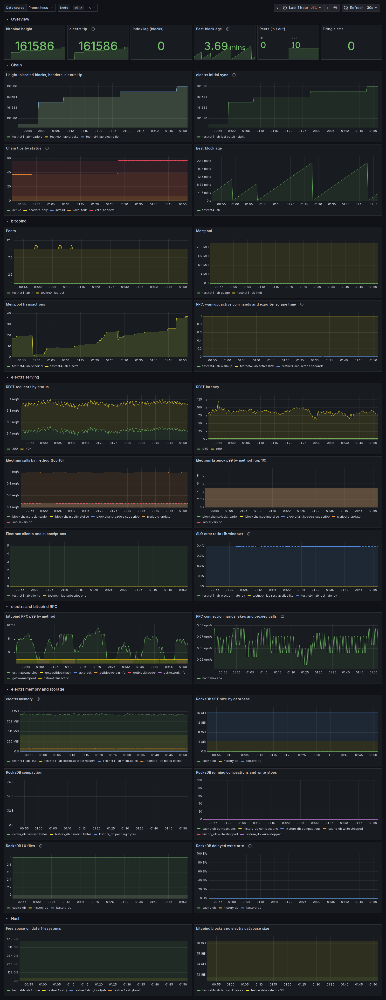

# bitcoin-node-monitoring

Prometheus alerts, recording rules, a Grafana dashboard and runbooks for running
**bitcoind** with **[Blockstream electrs](https://github.com/Blockstream/electrs)**
(the indexer behind Esplora). It also contains a small bitcoind exporter, because
bitcoind has no Prometheus endpoint.

It is written for the person on call: every alert is meant to be actionable, waits long enough (`for:`, or
`keep_firing_for:` on the counter alerts) not to flap, and links to a runbook with triage commands, likely causes,
mitigation, and when to escalate.



- [What it covers](#what-it-covers)
- [Quickstart](#quickstart)
- [Label conventions](#label-conventions)
- [Alerts](#alerts)
- [Metrics sources](#metrics-sources)
- [Tuning](#tuning)
- [How it was validated](#how-it-was-validated)
- [Game day](#game-day)
- [Repository layout and development](#repository-layout-and-development)

## What it covers

- **Chain health:** bitcoind down, stuck in startup, no or few peers, no new blocks, behind your other nodes,
  rejecting a chain that is ahead of its own (a consensus split, as in March 2013), validated chain behind headers, initial block download stalled, node warnings, restart loops.
- **Indexer health:** electrs down, index behind bitcoind, initial sync stalled (without firing during the hours-long
  full compaction that follows it), main loop stuck, reorg cleanup failing, RocksDB write delays, write stops and
  background errors, mempool sync failures, restart loops.
- **Missing targets:** a job with no targets at all, or one half of a bitcoind + electrs pair not scraped, alerts like
  a target that is down. On Kubernetes that is how a Pending pod or a ServiceMonitor that stopped matching shows up.
- **electrs ↔ bitcoind RPC:** connections refused, rejected or not answered (for example at bitcoind's
  `-rpcmaxconnections`), proxied client calls with no free slot or no answer, slow RPC.
- **Serving SLOs:** multi-window, multi-burn-rate alerts for REST availability, REST latency and Electrum latency.
- **Capacity:** electrs memory against a budget (hosts) or its container limit (Kubernetes), OOM kills, file-descriptor
  exhaustion, data disks (node_exporter) and PersistentVolumeClaims (kubelet) filling.
- **Routing:** an Alertmanager config that pages on `critical`, opens a ticket on `warning`, and holds back the
  electrs and chain alerts that are only symptoms while bitcoind or electrs is down.

## Quickstart

### Prometheus on a host

1. Run the exporter next to bitcoind (Python 3.8+, standard library only):

   ```sh
   BITCOIND_RPC_URL=http://127.0.0.1:8332/ \
   BITCOIND_RPC_COOKIE=/var/lib/bitcoind/.cookie \
   EXPORTER_LISTEN=127.0.0.1:9332 \
   python3 -I exporter/bitcoind_exporter.py
   ```

   A hardened systemd unit is in [`examples/bitcoind-exporter.service`](examples/bitcoind-exporter.service). Rather
   than the cookie, you can give the exporter its own read-only RPC user:

   ```ini
   # bitcoin.conf
   rpcauth=exporter:<salt>$<hash>        # from share/rpcauth/rpcauth.py
   rpcwhitelist=exporter:getblockchaininfo,getnetworkinfo,getmempoolinfo,getrpcinfo,uptime,getchaintips
   ```

2. Start electrs with `--monitoring-addr` (for example `127.0.0.1:4224`).

3. Add the scrape jobs and rule files from [`examples/prometheus.yml`](examples/prometheus.yml). The electrs job needs
   `fallback_scrape_protocol: PrometheusText0.0.4`: electrs serves `/metrics` without a `Content-Type` header, and
   Prometheus 3 refuses such targets (`non-compliant scrape target sending blank Content-Type`).
   Blockstream/electrs#270 adds the header; until a release has it, keep the fallback.

4. Route the alerts: [`examples/alertmanager.yml`](examples/alertmanager.yml) pages on `critical`, sends `warning`
   to a ticket receiver, and has the inhibit rules. Replace its two webhook URLs with your paging and ticketing
   integrations.

5. Import [`dashboards/bitcoin-node.json`](dashboards/bitcoin-node.json) into Grafana.

6. Set your memory budget for electrs in [`rules/bitcoin-node.rules.yml`](rules/bitcoin-node.rules.yml)
   (`bitcoin_node:electrs_memory_budget_bytes`, 64 GiB by default).

### Kubernetes (prometheus-operator, Flux or plain Kustomize)

```yaml
# kustomization.yaml in your cluster repository
resources:
  - https://github.com/shanurwan/bitcoin-node-monitoring//kubernetes/base?ref=main
  - https://github.com/shanurwan/bitcoin-node-monitoring//kubernetes/exporter?ref=main
```

- `kubernetes/base` is a `PrometheusRule` with every rule in `rules/`, and the dashboard as a ConfigMap labelled
  `grafana_dashboard: "1"` for the Grafana sidecar. If your Prometheus selects rules by label (kube-prometheus-stack
  uses `release: <name>` by default), add that label with a Kustomize patch. For Mimir, Grafana Alloy's
  `mimir.rules.kubernetes` component loads `PrometheusRule` objects into the Mimir ruler.
- `kubernetes/exporter` runs the exporter (non-root, read-only root filesystem, image pinned by digest) against a
  `bitcoind` Service, reading RPC credentials from a Secret named `bitcoind-rpc` (`user`, `password`), and adds
  `ServiceMonitor`s for the exporter and for electrs. The `node` label comes from the pod label `bitcoin-node`: give
  the exporter pod and the electrs pod of one pair the same value. Patch the Service selectors, the RPC URL and that
  label. The electrs ServiceMonitor sets `fallbackScrapeProtocol`, which needs prometheus-operator v0.79 or later.
- The Kubernetes-only alerts assume a container named `electrs` (`ElectrsContainerMemoryHigh`, from cAdvisor and
  kube-state-metrics) and claims whose names contain `bitcoin` or `electrs` (`BitcoinNodeVolume*`, from kubelet
  volume stats). On hosts they have no data and stay quiet.

Pin `ref=` to a commit for production.

## Label conventions

The rules join bitcoind and electrs metrics, so the scrape configuration has to label them consistently:

| Label | Value |
|---|---|
| `job` | `bitcoind` for the exporter, `electrs` for electrs, `node` for node_exporter |
| `node` | the same value on all targets of one bitcoind + electrs pair, for example `mainnet-1` |

If your job names differ, either relabel them or replace the `job="..."` selectors in `rules/`.

## Alerts

`critical` is meant to page; `warning` is meant for a ticket or chat channel.

| Alert | Severity | Fires when | Runbook |
|---|---|---|---|
| BitcoindDown | critical | RPC not answering, exporter not scraped, or no exporter target, for 5m (not during warmup) | [bitcoind-down](runbooks/bitcoind-down.md) |
| BitcoindWarmupTooLong | critical | RPC answers only "in warmup" (-28) for 30m | [bitcoind-down](runbooks/bitcoind-down.md#still-warming-up) |
| BitcoindNoPeers | critical | zero P2P connections for 10m | [bitcoind-no-peers](runbooks/bitcoind-no-peers.md) |
| BitcoindLowOutboundPeers | warning | fewer than 4 outbound peers for 30m | [bitcoind-low-outbound-peers](runbooks/bitcoind-low-outbound-peers.md) |
| BitcoindNoNewBlocks | warning | height unchanged for 95m outside IBD | [bitcoind-no-new-blocks](runbooks/bitcoind-no-new-blocks.md) |
| BitcoindBehindFleet | critical | more than 2 blocks behind your highest node for 10m, outside IBD | [bitcoind-no-new-blocks](runbooks/bitcoind-no-new-blocks.md) |
| BitcoindRejectedChainAhead | critical | a block above this node's tip marked invalid for 10m: a chain split or an invalid chain | [bitcoind-rejected-chain-ahead](runbooks/bitcoind-rejected-chain-ahead.md) |
| BitcoindBlocksBehindHeaders | warning | more than 2 unvalidated headers for 30m outside IBD | [bitcoind-blocks-behind-headers](runbooks/bitcoind-blocks-behind-headers.md) |
| BitcoindInitialBlockDownloadStalled | warning | in IBD and height unchanged for 45m | [bitcoind-initial-block-download-stalled](runbooks/bitcoind-initial-block-download-stalled.md) |
| BitcoindRestartLoop | warning | 3 or more restarts in 1h | [bitcoind-restart-loop](runbooks/bitcoind-restart-loop.md) |
| BitcoindWarnings | warning | `getblockchaininfo` warnings for 15m | [bitcoind-warnings](runbooks/bitcoind-warnings.md) |
| ElectrsDown | critical | electrs not scraped, or no electrs target, for 5m | [electrs-down](runbooks/electrs-down.md) |
| ElectrsIndexBehind | critical | synced electrs more than 3 blocks behind bitcoind for 10m | [electrs-index-behind](runbooks/electrs-index-behind.md) |
| ElectrsInitialSyncStalled | warning | initial sync, no batch for 45m, RocksDB not compacting | [electrs-initial-sync-stalled](runbooks/electrs-initial-sync-stalled.md) |
| ElectrsMainLoopStalled | critical | main loop counter unchanged for 15m while bitcoind is up | [electrs-main-loop-stalled](runbooks/electrs-main-loop-stalled.md) |
| ElectrsStaleCleanupFailing | critical | reorg cleanup failing for 10m | [electrs-stale-cleanup-failing](runbooks/electrs-stale-cleanup-failing.md) |
| ElectrsRocksDBWriteStopped | critical | RocksDB stopped writes for 5m | [electrs-rocksdb-write-stopped](runbooks/electrs-rocksdb-write-stopped.md) |
| ElectrsRocksDBWriteDelayed | warning | RocksDB throttling writes for 15m after the initial sync | [electrs-rocksdb-write-stopped](runbooks/electrs-rocksdb-write-stopped.md) |
| ElectrsRocksDBBackgroundErrors | critical | any RocksDB background error in 15m | [electrs-rocksdb-background-errors](runbooks/electrs-rocksdb-background-errors.md) |
| ElectrsBitcoindRPCErrors | warning | RPC handshakes failing, or proxied calls busy or unavailable, for 5m | [electrs-bitcoind-rpc-errors](runbooks/electrs-bitcoind-rpc-errors.md) |
| ElectrsBitcoindRPCSlow | warning | bitcoind RPC p99 (excluding `getblock`) above 2.5s for 15m | [electrs-bitcoind-rpc-slow](runbooks/electrs-bitcoind-rpc-slow.md) |
| ElectrsMempoolSyncFailing | warning | more than 2 mempool sync failures in 30m | [electrs-mempool-sync-failing](runbooks/electrs-mempool-sync-failing.md) |
| ElectrsElectrumFdLimit | warning | Electrum connections refused at the fd limit | [electrs-electrum-fd-limit](runbooks/electrs-electrum-fd-limit.md) |
| ElectrsRestartLoop | warning | 3 or more restarts in 1h | [electrs-restart-loop](runbooks/electrs-restart-loop.md) |
| ElectrsMemoryHigh | warning | RSS above 85% of the memory budget for 10m | [electrs-memory-high](runbooks/electrs-memory-high.md) |
| ElectrsContainerMemoryHigh | warning | container working set above 85% of its limit for 10m | [electrs-memory-high](runbooks/electrs-memory-high.md) |
| BitcoinNodeOOMKilled | warning | the kernel killed a process for memory, or a bitcoind/electrs container exited OOMKilled, in the last 5m | [electrs-memory-high](runbooks/electrs-memory-high.md#oom-kills) |
| BitcoinNodeDiskWillFill | warning | filesystem full within 48h at the 6h trend, already over 75% used | [bitcoin-node-disk](runbooks/bitcoin-node-disk.md) |
| BitcoinNodeDiskAlmostFull | critical | less than 5% free for 5m | [bitcoin-node-disk](runbooks/bitcoin-node-disk.md) |
| BitcoinNodeVolumeWillFill / AlmostFull | warning / critical | the same two, for PersistentVolumeClaims | [bitcoin-node-disk](runbooks/bitcoin-node-disk.md) |
| ElectrsRESTAvailabilityBurnFast / Slow | critical / warning | 5xx ratio burning the 99.5% objective | [electrs-rest-availability-slo](runbooks/electrs-rest-availability-slo.md) |
| ElectrsRESTLatencyBurnFast / Slow | critical / warning | requests over 1s burning the 99% objective | [electrs-rest-latency-slo](runbooks/electrs-rest-latency-slo.md) |
| ElectrsElectrumLatencyBurnFast / Slow | critical / warning | calls over 2.5s burning the 99% objective | [electrs-electrum-latency-slo](runbooks/electrs-electrum-latency-slo.md) |

### Design choices worth knowing

- **One page per incident.** electrs retries forever while bitcoind is unreachable or warming up, so its main loop
  stops and its RPC handshakes fail. `ElectrsMainLoopStalled` and `ElectrsBitcoindRPCErrors` are suppressed while
  `bitcoind_up` is 0 for the same node; `BitcoindDown` or `BitcoindWarmupTooLong` is the page.
- **Warmup is not "up".** During startup bitcoind answers a JSON-RPC batch with HTTP 200 and error -28 for every call.
  The exporter reports that as `bitcoind_up 0` and `bitcoind_rpc_warmup 1`. A normal restart does not page;
  a warmup longer than 30 minutes does.
- **"No progress" alerts compare with an offset, not `changes()`.** `changes(x[90m]) == 0` is true as soon as Prometheus
  restarts or a target appears, because the window has a single sample. `x - x offset 90m == 0` returns nothing until a
  sample from 90 minutes ago exists, so these alerts cannot fire on a fresh Prometheus.
- **A slow network is not a page.** No mainnet block for 95 minutes happens about four times a year, on every node at
  once, so `BitcoindNoNewBlocks` is a warning. The page is `BitcoindBehindFleet`: one node stuck while your others
  move on. With a single node, the warning plus `BitcoindNoPeers` and `BitcoindBlocksBehindHeaders` are what you have.
- **Block timestamps are not used.** Miners can set header times up to two hours ahead; on testnet4 the tip's
  timestamp is routinely more than an hour in the future, which made "time since the best block" negative. The
  exporter records when it first saw the current tip, and the dashboard's best-block age and the alerts use that or
  the height.
- **Initial sync is detected from `tip_height == 0`.** electrs sets `tip_height` only when the initial sync, including
  its one-time full compaction, has finished. `initial_sync_progress_pct` comes from the height of the last batch, so
  the rules do not use it.
- **SLO alerts.** The page tier (14.4x over 1h and 5m, 6x over 6h and 30m) and the 1x over 3d and 6h ticket tier are
  from the Google SRE workbook; the 3x over 1d and 2h ticket tier is the extra one Sloth and Pyrra add. They are
  suppressed below one request per minute, where ratios are noise. Only the 5-minute rules read the raw histograms;
  longer windows are computed from the recorded 5-minute rates, which keeps the 1d and 3d windows cheap on Mimir.
- **Counters that appear on their first event.** electrs creates some labelled counters only when the first event of
  that kind happens (`electrum_connection_errors_total{reason="fd_limit"}`, `daemon_rpc_conn_handshake{result}`,
  `daemon_rpc_proxied{result}`), and `increase()` cannot see the step from "no series" to 1.
  `ElectrsElectrumFdLimit`, where a single event matters, also fires on a series that did not exist 10 minutes ago.

## Metrics sources

### bitcoind: `exporter/bitcoind_exporter.py`

Existing exporters (for example jvstein/bitcoin-prometheus-exporter) do not expose the header height, the
initial-block-download flag or the best block time, which the chain-health alerts need. This exporter is about 270
lines of standard-library Python. It sends one JSON-RPC batch (`getblockchaininfo`, `getnetworkinfo`,
`getmempoolinfo`, `getrpcinfo`, `uptime`, `getchaintips`) per scrape, so there is no background polling and no stale
cache. It re-reads the cookie file on every scrape, so bitcoind restarts are picked up.

| Metric | Meaning |
|---|---|
| `bitcoind_up` | 1 if bitcoind answered `getblockchaininfo` on this scrape |
| `bitcoind_rpc_warmup` | 1 if bitcoind answered "in warmup" (-28) |
| `bitcoind_blocks`, `bitcoind_headers` | validated height and header height |
| `bitcoind_initial_block_download`, `bitcoind_verification_progress` | IBD flag and progress |
| `bitcoind_best_block_seen_timestamp_seconds` | when the exporter first saw the current best block |
| `bitcoind_best_block_timestamp_seconds`, `bitcoind_best_block_median_time_seconds` | best block header time, median time past |
| `bitcoind_peers{direction}` | inbound / outbound peers |
| `bitcoind_network_active`, `bitcoind_warnings`, `bitcoind_uptime_seconds`, `bitcoind_pruned` | node state |
| `bitcoind_mempool_transactions`, `_usage_bytes`, `_max_bytes`, `_min_fee_btc_per_kvb`, `_loaded` | mempool |
| `bitcoind_rpc_active_commands` | RPC commands running at scrape time |
| `bitcoind_chain_tips{status}` | chain tips by status (`valid-fork` grows with stale blocks and reorgs) |
| `bitcoind_size_on_disk_bytes`, `bitcoind_info{chain,version,subversion}` | size and version |
| `bitcoind_exporter_rpc_errors_total{method}`, `bitcoind_exporter_scrape_duration_seconds` | exporter health |

### electrs: `--monitoring-addr`

The rules use electrs's own metrics, checked against Blockstream/electrs `new-index` at 4e8e6fe (2026-11-11):
`tip_height`, `initial_sync_height`, `initial_sync_progress_pct`, `electrs_main_loop_count`, `stale_cleanup_failing`,
`rocksdb_*{db}` (per database: `txstore_db`, `history_db`, `cache_db`), `daemon_rpc{method}`,
`daemon_rpc_conn_handshake{result}`, `daemon_rpc_proxied{result}`, `rest_request_duration_seconds{method,route,status}`,
`electrum_rpc{method}`, `electrum_clients`, `electrum_subscriptions`, `electrum_connection_errors_total{reason}`,
`mempool_count{type}`, `mempool_sync_failed_to_index`, `process_memory_rss`, `process_cpu_usage`, `process_fs_fds`.

Several of these appear only after the first event of their kind: the REST and Electrum latency histograms (per route
and method, on the first request), `daemon_rpc_proxied` (on the first proxied call, such as a broadcast), and some
`electrum_connection_errors_total` and `daemon_rpc_conn_handshake` labels. On a node nobody queries, the serving panels
and SLO rules are empty. [`scripts/electrs_traffic.py`](scripts/electrs_traffic.py) sends light REST and Electrum
traffic to fill them.

### Host and Kubernetes

The disk alerts use `node_filesystem_avail_bytes` / `node_filesystem_size_bytes` from node_exporter with `job="node"`,
and `kubelet_volume_stats_available_bytes` / `kubelet_volume_stats_capacity_bytes` for claims.
`ElectrsContainerMemoryHigh` uses `container_memory_working_set_bytes` (cAdvisor) and
`kube_pod_container_resource_limits` (kube-state-metrics).

## Tuning

- **Memory budget:** `bitcoin_node:electrs_memory_budget_bytes` in `rules/bitcoin-node.rules.yml`. Size it for the
  initial sync and full compaction, not for steady state.
- **Which claims count as node data:** the `persistentvolumeclaim=~".*(bitcoin|electrs).*"` selector in
  `rules/bitcoin-node.alerts.yml`.
- **SLO objectives and thresholds:** `SLOS` in `scripts/generate.py`, then run the generator.
- **Thresholds and `for:` durations:** edit `rules/bitcoin-node.alerts.yml`, update the cases in
  `tests/alerts.test.yml`, and run the tests.

## How it was validated

**Unit tests.** `tests/alerts.test.yml` has 56 test groups and 115 evaluations. Every one of the 37 alerts has at least
one case where it must fire and one where it must not, including: a fresh Prometheus with no history (no "no progress"
alerts), bitcoind warming up (not "down"), a node with no bitcoind or no electrs target, one node behind the others
and a node in IBD (not "behind the fleet"), electrs's main loop and RPC errors while bitcoind is down (bitcoind's
alert, not electrs's), rejected client transactions (not RPC errors), the first fd-limit refusal creating its series,
a one-block lag while electrs indexes a new block, electrs in initial sync (not "behind"), the post-sync full
compaction (not "stalled"), slow `getblock` calls (ignored), high error ratios on almost no traffic (no page), and
Prometheus 3's normalised `le="1.0"` bucket label. The expected annotations are part of the tests, so a broken
template fails them.

`tests/test_exporter.py` runs the exporter against a fake bitcoind: a healthy node, warmup (-28 on every call), one
failed method, the pre-28.0 string `warnings`, a malformed batch reply, an HTTP error, the tip-seen time, and the
height of a chain tip the node marked invalid.

**Live run** on a lab host (12 cores, 30 GB RAM) against testnet4: Bitcoin Core 32.1 (synced, about 161,550 blocks),
electrs built from `new-index` 4e8e6fe plus Blockstream/electrs#268 (needed for the `--blocks-dir` initial sync, see
electrs#214), the exporter, and node_exporter, scraped every 15 s by Prometheus 3.15.1, with Grafana 12.2.1 and
`scripts/electrs_traffic.py` sending about 4 REST requests and 3 Electrum calls per second.

- All 79 rules loaded and evaluated with `health=ok`, and every recording rule returned data. The only alert selectors
  without series were the Kubernetes metrics (this host is not Kubernetes) and `daemon_rpc_proxied` (no transactions
  were broadcast). `scripts/check_live.py` does this check.
- Every dashboard query was run with the `node` variable resolved: 43 of 44 returned data, none errored, and the empty
  one is `daemon_rpc_proxied`.
- Bitcoin Core 32.1 in regtest, queried during startup, answered the exporter's batch with HTTP 200 and
  `{"code":-28,"message":"Loading block index…"}` for each call.
- The exporter's output passes `promtool check metrics`.
- **Induced failures:**
  - Stopping electrs and the exporter at 11:02:14 UTC: `ElectrsDown` and `BitcoindDown` went pending at 11:02:28–30 and
    were firing at 11:07:35.
  - `bitcoin-cli setnetworkactive false` at 11:08:35 UTC: the exporter reported 0 peers, `BitcoindNoPeers` went
    pending at 11:08:45 and was firing by 11:18:46 (its `for:` is 10 minutes). `BitcoindLowOutboundPeers` stayed
    pending, as it needs 30 minutes. After `setnetworkactive true` bitcoind had 5 peers within 30 seconds and the
    alerts cleared.
- Found along the way: Prometheus 3 rejects electrs's metrics endpoint unless the scrape job sets a fallback protocol
  (Blockstream/electrs#270, not merged at the time of writing, adds the missing header); and testnet4 block
  timestamps run ahead of the clock (see above).

**Measurements behind the memory and compaction guidance** (two full testnet4 initial syncs with default electrs
settings and `--blocks-dir`, using the #268 build, 17 GB database): peak RSS 5.8 GiB, during indexing rather than
compaction (about 4.1 GiB while compacting); RocksDB table readers 0.4 GiB at 16 GB of SST files; RocksDB never
stopped or delayed writes and recorded no background errors, so the RocksDB alerts do not fire during a normal sync.
Mainnet needs much more memory: an electrs maintainer
[reports](https://github.com/Blockstream/electrs/issues/215#issuecomment-4508569410) using machines with at least
64 GB for a mainnet initial sync and compaction.

## Game day

Six failures were injected into the live lab, each modelled on a public incident, with Alertmanager routing
[`examples/alertmanager.yml`](examples/alertmanager.yml) to a recorder.
[`gameday/gameday.py`](gameday/gameday.py) acted as the on-call engineer: it waited two minutes after the first
page or ticket, applied the runbook's fix, and waited for every alert to resolve.

**[Replay each drill in 3D](https://shanurwan.github.io/bitcoin-node-monitoring/)**, with links to the incidents
they are based on. The write-up is in [docs/game-day.md](docs/game-day.md).

| Drill | Based on | First notification after the fault | Pages | Fix applied | All clear |
|---|---|---|---|---|---|
| [bitcoind crashes](https://shanurwan.github.io/bitcoin-node-monitoring/#bitcoind-crash) | [CVE-2018-17144](https://bitcoincore.org/en/2018/09/20/notice/) | 5m 29s page: BitcoindDown | 1 | +7m 29s | +8m 04s |
| [Node rejects the network's chain](https://shanurwan.github.io/bitcoin-node-monitoring/#consensus-split) | [BIP 50: the March 2013 chain fork](https://github.com/bitcoin/bips/blob/master/bip-0050.mediawiki) | 10m 44s page: BitcoindRejectedChainAhead | 1 | +12m 44s | +19m 19s |
| [Node cut off from its peers](https://shanurwan.github.io/bitcoin-node-monitoring/#network-isolation) | [bitcoin/bitcoin#48](https://github.com/bitcoin/bitcoin/issues/48) | 10m 39s page: BitcoindNoPeers | 1 | +12m 39s | +14m 39s |
| [electrs killed for memory](https://shanurwan.github.io/bitcoin-node-monitoring/#electrs-oom) | [Blockstream/electrs#215](https://github.com/Blockstream/electrs/issues/215) | 5m 52s page: ElectrsDown | 1 | +7m 52s | +9m 55s |
| [bitcoind RPC overloaded](https://shanurwan.github.io/bitcoin-node-monitoring/#rpc-overload) | [mempool/mempool#4178](https://github.com/mempool/mempool/issues/4178) | 6m 04s page: ElectrsDown | 1 | +8m 04s | +10m 05s |
| [The exporter vanishes](https://shanurwan.github.io/bitcoin-node-monitoring/#monitoring-gap) | [GitLab.com database outage](https://about.gitlab.com/blog/2017/02/10/postmortem-of-database-outage-of-january-31/) | 10m 33s page: BitcoindDown | 2 | +12m 33s | +14m 34s |

Times are from the fault. *Fix applied* includes the two minutes the script waited before acting. The exporter
drill's two pages are the double page found by the drill and since fixed; the rerun with the fix paged once.

The drills found five problems that the rule tests had not caught:
- No alert for a node that rejects the chain the network follows. It is now covered by `BitcoindRejectedChainAhead`.
- An electrs OOM loop that killed electrs before every scrape, so the memory and restart-loop alerts had no samples.
  It is now covered by `BitcoinNodeOOMKilled`.
- A double page when a scrape job disappears. Fixed in `BitcoindDown` and `ElectrsDown`.
- A 5-minute detection delay after a scrape job is removed, now explained in the runbook.
- electrs exits when bitcoind answers `503 Work queue depth exceeded`, so a burst of RPC load becomes an indexer
  outage. An electrs patch that retries is ready to go upstream.

## Repository layout and development

```text
exporter/                  bitcoind exporter (standard library Python)
rules/                     recording rules, alerts, and generated SLO rules
tests/alerts.test.yml      promtool unit tests
tests/test_exporter.py     exporter tests against a fake bitcoind
dashboards/                Grafana dashboard (generated)
runbooks/                  one runbook per alert, and the shared handoff note
kubernetes/base/           PrometheusRule + dashboard ConfigMap (generated)
kubernetes/exporter/       exporter Deployment, Service, ServiceMonitors
examples/                  Prometheus and Alertmanager config, systemd unit
gameday/                   game-day drills and recorder, and the replay page builder
docs/                      game-day write-up and the replay page (GitHub Pages)
scripts/generate.py        generates the SLO rules, PrometheusRule and dashboard
scripts/check_live.py      checks rules and dashboard against a running Prometheus
scripts/lint_dashboard.py  static checks for the dashboard
scripts/electrs_traffic.py light REST and Electrum traffic for a test electrs
```

```sh
python3 scripts/generate.py                 # after editing rules or SLOS
promtool check rules rules/*.yml
promtool test rules tests/alerts.test.yml
python3 -m unittest discover -s tests
python3 scripts/lint_dashboard.py
python3 scripts/check_live.py --prometheus http://127.0.0.1:9090 --dashboard dashboards/bitcoin-node.json
```

CI runs all of these except the live check, and fails if generated files are out of date.

## License

Apache-2.0. See [LICENSE](LICENSE).
